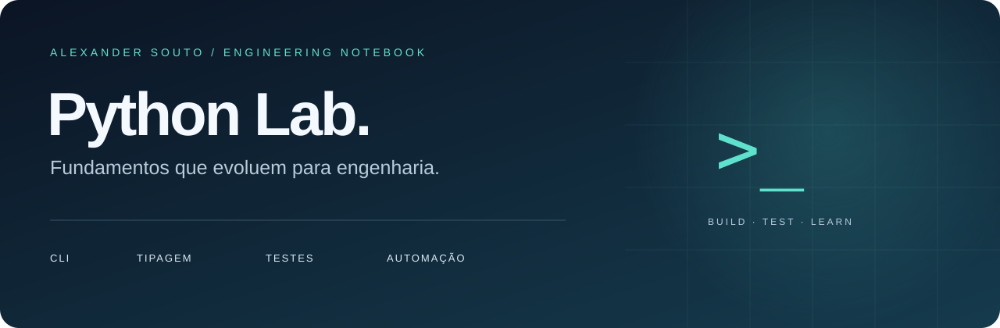

# Python Lab · Teste de habilidades

**Cinco exercícios. Uma base de engenharia.** Laboratório de evolução em Python com ferramentas de terminal, regras testáveis e instalação reproduzível.

[](https://github.com/4L3xSGS/Teste_de_habilidades/actions/workflows/quality.yml)


[Começar](#começar) · [Projetos](#projetos) · [Engenharia](docs/architecture.md) · [Contribuir](CONTRIBUTING.md)

## O projeto

Este repositório começou com scripts de aprendizado e agora reúne as mesmas ideias em um pacote instalável. A evolução mostra separação entre regras e interface, tratamento de erros, uso adequado de aleatoriedade, tipagem estática e testes automatizados.

**Autor:** [Alexander Souto](https://github.com/4L3xSGS). Projeto de portfólio e estudo; não é um sistema comercial nem um gerenciador de senhas.

## Projetos

| Módulo | O que faz | Competência demonstrada |
| --- | --- | --- |
| Calculadora | Quatro operações; rejeita divisão por zero, NaN, infinito e overflow | Contratos numéricos e erros explícitos |
| Cara ou coroa | Sorteio com escolha opcional do jogador | Separação entre sorteio e apresentação |
| Dados | Quantidade e faces configuráveis; total calculado | Validação de limites e dependência injetável |
| Senhas | Geração local com `secrets`; garante presença dos grupos habilitados | Aleatoriedade adequada e política verificável |
| Forca | Estado imutável, tentativas controladas e palpites repetidos sem penalidade | Modelagem de estado e transições |

## Começar

Requisitos: **Python 3.12+** e [uv](https://docs.astral.sh/uv/getting-started/installation/). O Python 3.15 também faz parte da matriz de verificação. `uv` pode obter o interpretador solicitado.

```bash
git clone https://github.com/4L3xSGS/Teste_de_habilidades.git
cd Teste_de_habilidades
uv sync --locked
uv run habilidades --help
```

### Experimentar em um minuto

```bash
uv run habilidades calcular 7 / 2
# Resultado: 3.5

uv run habilidades moeda --escolha cara
uv run habilidades dados --quantidade 4 --faces 20
uv run habilidades senha --tamanho 24
uv run habilidades forca
```

Coloque `"*"` entre aspas ao multiplicar para evitar expansão de arquivos pelo shell:

```bash
uv run habilidades calcular 6 "*" 7
# Resultado: 42
```

### Automatizar com JSON

```bash
uv run habilidades calcular 7 / 2 --json
# {"resultado": 3.5}

uv run habilidades dados --quantidade 3 --faces 6 --json
uv run habilidades senha --tamanho 20 --sem-simbolos --json
```

`--json` está disponível em `calcular`, `moeda`, `dados` e `senha`. A forca é interativa. O terminal retorna **0** em sucesso, **2** em uso/entrada inválida e **130** quando uma interação é interrompida por Ctrl+C ou fim da entrada. Erros vão para `stderr`, mantendo `stdout` utilizável por outros programas. Os números da calculadora usam ponto decimal.

As senhas são exibidas em texto no terminal ou JSON. Não são salvas nem transmitidas pelo aplicativo; evite executar esse comando em logs compartilhados. O gerador não oferece armazenamento, avaliação de vazamentos ou auditoria criptográfica independente.

### Sem uv

```bash
python -m venv .venv
# Ative o ambiente conforme o seu sistema operacional.
python -m pip install .
python -m habilidades --help
```

Após instalado, o pacote funciona com a biblioteca padrão, sem conexão externa. A instalação das ferramentas de desenvolvimento exige acesso ao índice de pacotes.

## Qualidade verificável

```bash
uv run ruff check .
uv run ruff format --check .
uv run mypy
uv run pytest
uv build
```

- **Ruff:** lint, regras de segurança e formatação.
- **mypy:** análise estrita do pacote.
- **pytest + coverage:** regras, erros, CLI, JSON e estado dos jogos; piso de cobertura de 90%, incluindo branches.
- **GitHub Actions:** verificações e testes em Linux/Windows com Python 3.12, 3.13, 3.14 e 3.15.
- **uv.lock:** versões resolvidas das ferramentas; CI usa `--locked` para detectar divergências.
- **Dependabot:** configuração de atualização mensal para ferramentas e ações do GitHub.

O estado real das verificações está no badge e no histórico de Actions. Cobertura mede execução, não garante ausência de defeitos. A suíte evita conclusões de segurança baseadas apenas em amostras aleatórias e usa fontes controladas nos testes dos jogos.

## Estrutura

```text
src/habilidades/       Pacote tipado: regras e CLI
tests/                 Contratos, transições e integração
docs/                  Arquitetura e identidade do projeto
.github/workflows/     Verificação contínua
pyproject.toml         Metadados e configurações de ferramentas
uv.lock                Ambiente reproduzível
*.py na raiz           Entradas históricas preservadas
```

Os cinco arquivos originais continuam disponíveis. Execute, por exemplo, `uv run python calculadora2.py`. Importá-los não inicia jogos, não solicita entrada e não gera senhas. A função histórica `dividir` agora lança `ValueError` para divisão por zero em vez de retornar uma string; isso mantém o resultado numérico consistente. O gerador histórico passa a aceitar tamanhos de 8 a 1.024 caracteres.

## Evolução do portfólio

O foco atual é demonstrar fundamentos e práticas de manutenção em um projeto pequeno. Próximas melhorias devem partir de necessidades concretas: mais casos de uso, documentação e métricas observadas. Não há banco de dados, API web ou integração de IA sem uma finalidade definida para estes exercícios.

Leia as [decisões de arquitetura](docs/architecture.md) e o [histórico de mudanças](CHANGELOG.md).
